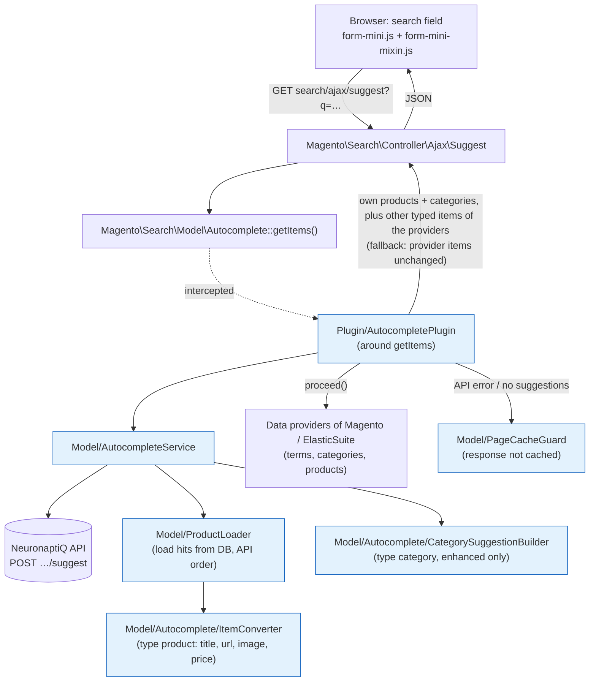
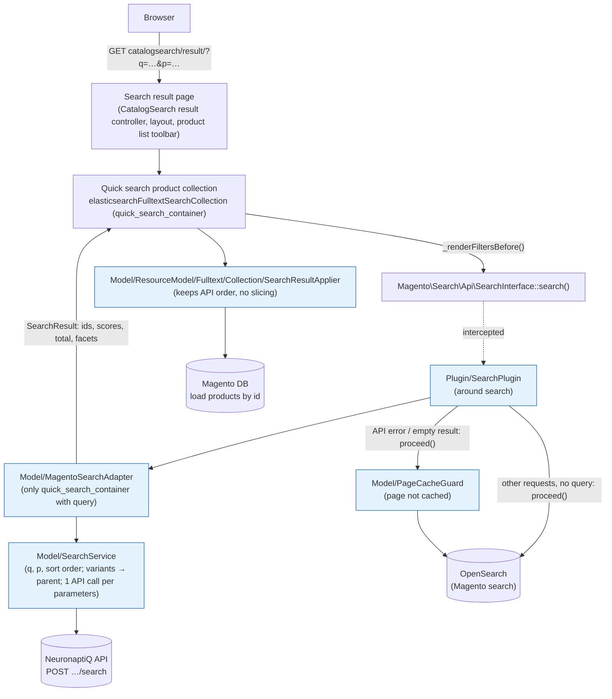

# NeuronaptiQ_Search

Magento 2 module that connects the shop to the **NeuronaptiQ** semantic search service. It replaces the
product suggestions and the catalog quick search with results from the NeuronaptiQ API, fills the
"Related Products" block with cross-sellings and tracks cart, checkout, order and login events.

Whenever the API is not configured, not reachable or responds with an error, the module falls back to the
standard Magento behavior, so the shop never breaks because of the external service.

- Composer package: `neuronaptiq/magento-search`
- Magento module: `NeuronaptiQ_Search`, namespace `NeuronaptiQ\Search`
- License: MIT

## Requirements

- Magento Open Source / Adobe Commerce 2.4.x (developed against 2.4.9)
- PHP 8.2 – 8.5
- Search engine OpenSearch (the quick search integration hooks into the OpenSearch/Elasticsearch fulltext
  collection). With Smile ElasticSuite, the search result page additionally needs the module
  `NeuronaptiQ_SearchElasticsuite` (package `neuronaptiq/magento-search-elasticsuite`); search suggestions,
  cross-sellings and tracking work without it
- A NeuronaptiQ instance and an integration token
- For the filters of the search result page (layered navigation, version 2.0.0 and newer): a search service with
  filters, facets and price ranges (see *Layered navigation*). An older search service returns no facets, the
  search works, the filter sidebar stays empty

## Installation

Via Composer (the package is available on packagist.org, no additional repository is needed):

```bash
composer require neuronaptiq/magento-search
bin/magento module:enable NeuronaptiQ_Search
bin/magento setup:upgrade
bin/magento setup:di:compile
bin/magento cache:flush
```

Manual installation from the zip package: extract it in the Magento root, it contains
`app/code/NeuronaptiQ/Search/`, then run the same `bin/magento` commands:

```bash
cd /path/to/magento
unzip neuronaptiq-search-<version>.zip
bin/magento module:enable NeuronaptiQ_Search
bin/magento setup:upgrade
bin/magento setup:di:compile
bin/magento cache:flush
```

In production mode, run `bin/magento setup:static-content:deploy` afterwards (the module ships JavaScript
and LESS).

Switching from the zip package to Composer: remove `app/code/NeuronaptiQ/Search` (and
`app/code/NeuronaptiQ/SearchElasticsuite`, if installed) before `composer require`, otherwise Magento finds the
modules twice. Configuration values are kept, they are stored in the database.

## Configuration

*Stores → Configuration → NeuronaptiQ → Search Settings → General Configuration*
(config path `neuronaptiq_search/general/*`, all fields available on default, website and store view scope)

| Field | Path | Default | Description |
|---|---|---|---|
| Enable Search | `search` | Yes | Use NeuronaptiQ for search suggestions and the quick search result page |
| Enable Cross-Sellings | `crosssellings` | No | Fill the "Related Products" block of the product page with NeuronaptiQ cross-sellings |
| Cross-Selling Limit | `crosssellings_limit` | 8 | Number of cross-selling products (1–20) |
| Send Customer Data | `send_customer_data` | No | Send data of logged-in customers to the API (requires a legal basis, see below) |
| Enable Tracking | `tracking` | Yes | Track cart changes, checkout, orders and logins |
| Environment | `environment` | prod | `dev`, `test` or `prod`, selects the API base URL |
| Instance Name | `name` | – | Name of the NeuronaptiQ instance (`https://{name}.synapse.neuronaptiq.ai`) |
| Token | `token` | – | Integration token (stored encrypted), sent as `Authorization: Bearer …` |
| API Timeout (Seconds) | `timeout` | 2 | Timeout of all API requests |
| Suggest Limit | `suggest_limit` | 5 | Maximum number of suggested products |
| Enhanced Search Suggestions | `enhanced_suggestions` | Yes | Image, price and direct link to the product page in the suggestions |
| Suggest Parent Products Instead of Variants | `suggest_parent_products` | No | Variant hits are suggested as their parent product (see *Search suggestions*) |
| Separate Log File | `separate_log_file` | Yes | Log to `var/log/neuronaptiq.log` instead of the Magento logger (default scope only, see *Logging*) |

API base URLs per environment:

| Environment | Base URL |
|---|---|
| `dev` | `http://host.docker.internal:8635` |
| `test`, `prod` | `https://{name}.synapse.neuronaptiq.ai` (empty instance name → API disabled, Magento fallback) |

All endpoints are below `/api/v1/search/ecomm/`.

## Features

### Search suggestions (autocomplete)

Code flow of a suggest request (module classes highlighted, dashed arrow = plugin interception):



- `Plugin/AutocompletePlugin` (around `Magento\Search\Model\AutocompleteInterface::getItems`) replaces the
  suggestions of `search/ajax/suggest` with the result of `POST …/suggest`.
- `Model/AutocompleteService` queries the API, `Model/ProductLoader` loads the hits from the database
  (enabled products only, in API score order), `Model/Autocomplete/ItemConverter` builds the autocomplete
  items.
- Variant hits link to the parent product, the variant is preselected via URL hash
  (`#attributeId=optionId&…`, built by `Model/VariantUrlHash`). Variant hits whose parent is not loaded
  (disabled, not in the website) are dropped: variants are usually not visible individually.
- **Suggest parent products instead of variants** (switch, default off): a variant hit is shown as its parent
  product (name, image and price of the parent, the variant image if the parent has none); the link keeps the
  variant preselection. Intended for the variant setting "Best variant" of the NeuronaptiQ integration, which
  returns one variant per parent product; the module does not remove duplicates. The search result page and the
  cross-sellings always show parent products, independent of the switch.
- **Enhanced suggestions** (switch): the items contain `url`, `image` (resized product thumbnail, falls back
  to the parent product's image) and `price` (final price from the price info; configurable, grouped and bundle
  products show the lowest price of their children, prefixed with "As low as", German "ab"). The JS mixin `view/frontend/web/js/form-mini-mixin.js` renders image and price and
  opens the product page directly when a suggestion is selected. Styling:
  `view/frontend/web/css/source/_module.less`. Without the switch, only the title is sent and Magento's
  default behavior applies (the suggestion text is searched).
- `price` is HTML, like in the product suggestions of Smile ElasticSuite: the default price is escaped text,
  the JS mixin and the ElasticSuite templates output the field unescaped.

#### Customizing the product suggestions

The product suggestions are built by `Model/Autocomplete/ItemConverter`, not by the item factory of the
installed search (e.g. `Smile\ElasticsuiteCatalog\Model\Autocomplete\Product\ItemFactory`). Plugins on that
factory therefore don't apply to them; customizations hook into the following extension points instead:

- **Additional attributes:** `Model/ProductLoader` loads only the attributes the suggestions need. Further
  attributes are added via the di.xml argument `additionalAttributes`:

  ```xml
  <type name="NeuronaptiQ\Search\Model\ProductLoader">
      <arguments>
          <argument name="additionalAttributes" xsi:type="array">
              <item name="nr_price_request" xsi:type="string">nr_price_request</item>
          </argument>
      </arguments>
  </type>
  ```

- **Event `neuronaptiq_search_autocomplete_product_item`:** dispatched for every product suggestion before
  the item is created, with

  | Key | Type | Content |
  |---|---|---|
  | `product` | `Magento\Catalog\Model\Product` | the displayed product (a variant for variant hits, the parent with *Suggest Parent Products Instead of Variants*) |
  | `parent` | `Magento\Catalog\Model\Product\|null` | parent product of a displayed variant |
  | `variant` | `Magento\Catalog\Model\Product\|null` | the found variant, if its parent is displayed instead |
  | `enhanced` | `bool` | enhanced suggestions enabled (only then `url`, `image` and `price` are set) |
  | `item_data` | `Magento\Framework\DataObject` | the item data; changes are applied to the item |

  Observers can change any field or add new ones, e.g. replace the complete price HTML. Values set in
  `price` are output unescaped, so the observer has to escape them. Exceptions in an observer drop the
  NeuronaptiQ suggestions (fallback to the Magento suggestions).

  ```php
  public function execute(\Magento\Framework\Event\Observer $observer): void
  {
      $product = $observer->getData('product');
      $itemData = $observer->getData('item_data');
      if ($observer->getData('enhanced') && $product->getData('nr_price_request')) {
          $itemData->setData(
              'price',
              '<span class="price-request">' . $this->escaper->escapeHtml(__('Price on request')) . '</span>'
          );
      }
  }
  ```

  Register the observer in `etc/frontend/events.xml` (suggest requests run in the frontend area).

### Quick search result page

Code flow of the search result page with the Magento search (OpenSearch/Elasticsearch); for Smile ElasticSuite
see the README of `NeuronaptiQ_SearchElasticsuite`:



- `Model/SearchService` is the search engine neutral part: it reads query (`q`), page (`p`) and sort order
  (`product_list_order`/`_dir`: `score`, `price`, `name`, `topseller`) from the request, calls
  `POST …/search` and returns the products to display (hits of children, i.e. variants of configurable,
  products of grouped and bundle products, mapped to their parent product, deduplicated, in API order; the hit
  children per parent as `childrenIds`) with the `total`. Results and errors are kept per request and search
  parameters, so repeated calls do not query the API again.
- Adapters convert this result for the search engine:
  - Magento search (OpenSearch/Elasticsearch): `Plugin/SearchPlugin` (around
    `Magento\Search\Api\SearchInterface::search`) and `Model/MagentoSearchAdapter` handle the
    `quick_search_container` request and build a Magento `SearchResult`. The API result is already paginated.
    `Model/ApiSearchResultRegistry` marks it, and the quick search collection uses
    `Model/ResourceModel/Fulltext/Collection/SearchResultApplier`, which keeps the API order and only slices
    results that do not come from the API. Category pages and the advanced search keep the core applier.
  - Smile ElasticSuite: module `NeuronaptiQ_SearchElasticsuite` (separate package), builds the ElasticSuite
    search response.

#### Layered navigation (filters and facets)

The filters of the search result page come from NeuronaptiQ as well: the selection is sent to the API and the
sidebar shows its facets and counts. This section describes the Magento search (OpenSearch/Elasticsearch); Smile
ElasticSuite is handled by `NeuronaptiQ_SearchElasticsuite` (multiselect, price slider, see its README).

**Setup for integrators:**

1. **Search service:** filters, facets, price ranges and exclusive price maximum (`params.filters`, `categoryIds`,
   `price.maxExclusive`, `facets`, `priceRanges`; response `facets` with `ranges`). The products must be synced
   with their attributes: the filter groups of the API are the **attribute codes**, the values the **option ids**
   of Magento, the categories with their ids (the Magento product feed of NeuronaptiQ does this).
2. **Variant mode of the integration: "Best variant"** (one variant per product). The counts are then per
   product like Magento's own. With other modes they count variants, and a product can appear with several
   variants among the hits.
3. **Attributes:** only attributes with *Stores → Attributes → Product → Storefront Properties → Use in Search
   Results Layered Navigation* (`is_filterable_in_search`) are shown on the search page, also the price. Labels,
   option order and swatches come from Magento. Facets of attributes the shop does not know are ignored.
4. **Price ranges:** *Stores → Configuration → Catalog → Catalog → Layered Navigation → Price Navigation Step
   Calculation* is sent to the API (see *Facets* below). *Automatic (equalize product counts)* is not supported
   by the API yet and uses the automatic step.
5. **Currency:** price bounds and ranges are in the **base currency** like in Magento (the labels are converted
   into the displayed currency); the module sends the base currency code. The API filters by the sale price:
   customer group and catalog rule prices are not considered, for guests and the default customer group both
   match.
6. **Checking:** with debug logging enabled (see *Logging*) every search request in the log shows the selection
   (`params.filters`, `price`, `categoryIds`) and the response the facets.

**How it works:**

- **Selection:** `Model/Search/CriteriaFilterReader` reads the filters of the layered navigation from the search
  criteria and sends them to the API (`params.filters`, `categoryIds`, `price`):
  - attributes: group = attribute code, values = option ids (OR within an attribute, AND between attributes)
  - category: the hard category filter (`categoryIds`), the context of the search
  - price: `price.from`/`price.to` in the base currency; the end of a range is sent as exclusive maximum
    (`maxExclusive`, Magento's `to − 0.001` is reverted), a single price (from = to) as inclusive maximum
  - `search_term`, `visibility` and `category_ids_to_aggregate` (limits OpenSearch's category aggregation, no
    filter) are not sent
- **Facets:** every quick search request asks for the facets (`params.facets`, `currency` = base currency code).
  The price ranges follow *Layered Navigation → Price Navigation Step Calculation*
  (`Model/Search/PriceRangesResolver`): "Manual" sends `step` and `maxIntervals`, "Automatic (equalize price
  ranges)" and "Automatic (equalize product counts)" (not supported by the API yet) the automatic step.
- **Aggregations:** `Model/Search/FacetAggregationBuilder` converts the facets into the buckets of the layered
  navigation: `<attribute code>_bucket` with option ids, `category_bucket` with category ids, `price_bucket` with
  the ranges as `<from>_<to>`. `Model/Search/FacetAggregation` returns an empty bucket for attributes without
  facet, Magento would throw an exception otherwise.
- The counts are disjunctive (the counts of an attribute ignore its own selection) and count products or rows
  depending on the variant setting of the integration ("Best variant": one per product).
- Labels, options and swatches come from Magento. Only attributes with *Use in Search Results Layered
  Navigation* (`is_filterable_in_search`) are shown on the search page, also for the price.
- A selection without hits keeps the page with its facets, so the selection can be removed; an empty first
  page without selection still falls back to the Magento search (see below).
- Requires a search service with filters and facets. Without facets in the response the layered navigation
  stays empty.

### Fallback to the Magento search

- On API errors and on empty API results, autocomplete and search result page use the Magento search
  (with Smile ElasticSuite its results). The API also answers requests it classifies as bots with an empty
  result, so a genuine "no results" cannot be distinguished and is handled the same way.
- Search result page: only an empty **first** page counts as empty result (whatever `total` the API reports).
  An empty later page means the visitor paged too far and is shown as such, without fallback; otherwise hits,
  total and pager would come from two different result sets. Pages beyond the API's result pool (1000 hits,
  100 when sorted by price/name/topseller) are answered with `total` 0, the page then shows "no results".
  Search result pages with a page parameter are not stored in the full page cache by Magento.
- Page sizes above the API maximum of 100 (`SearchService::MAX_LIMIT`, e.g. "show all", or collections without
  page size that request all hits for their facets) are not pages of the product list: they go to the Magento
  search without error log and stay cacheable. With Smile ElasticSuite the early facet request is answered from
  the API (see the README of `NeuronaptiQ_SearchElasticsuite`).
- These responses are excluded from the full page cache (`Model/PageCacheGuard`: no-cache headers, and
  `Plugin/SearchResultPageCachePlugin` reports the layout as not cacheable). Otherwise a single bot request
  would cache the fallback result of a search term (also the JSON of `search/ajax/suggest`) for all visitors.

### Cross-sellings

- `Plugin/RelatedProductsPlugin` (after `Related::getItems` / `Related::getProductUrl`) fills the
  "Related Products" block with the result of `POST …/xselling/{productId}` (`Model/CrossSellingService`).
- Products are loaded like in the core block (visible in catalog, prices, URL rewrites, stock filter); variant
  hits are shown as their parent product with a variant preselection hash on the product link.
- The block is rendered server side and cached by the full page cache. If cross-sellings are disabled, the
  API fails or returns no visible products, the maintained related products are shown.

### Tracking

`POST …/track`, synchronous, errors are only logged and never affect the customer.

| Event | Trigger | Conversion |
|---|---|---|
| Cart change | `checkout_cart_save_after` (frontend) | `cart`: full cart, total = subtotal incl. tax |
| Checkout visit | `controller_action_postdispatch_checkout_index_index` | `checkout`: grand total, shipping if already selected |
| Shipping method selected ("Review & Payments") | after `ShippingInformationManagementInterface::saveAddressInformation` (webapi_rest) | `checkout` with the selected shipping method |
| Order | `checkout_submit_all_after` (frontend, webapi_rest; one page checkout and multishipping) | `order`: order number, payment, shipping |
| Customer login | `customer_login` (frontend) | no conversion, customer data only (requires "Send Customer Data") |

- Products are sent with the id and name of the variant; `price` and `taxes` are row totals incl. tax.
- Orders and the shipping information are only tracked for the quote of the current checkout session, so
  orders created by other systems via the REST API are ignored. Admin orders are not tracked.
- Building the payload: `Model/Tracking/ConversionBuilder`, sending: `Model/Api/TrackingApiClient`,
  orchestration: `Model/TrackingService`.

### Session id (SID)

The API returns a session id that is sent with every following request. `Model/Session/SidManager` stores it
in the session cookie `neuronaptiq_sid` (HttpOnly, SameSite=Lax, path/domain of the Magento session cookie).
It is not stored in the Magento session, because Magento depersonalizes and closes the session on cacheable
pages before the search runs.

If a cookie consent tool is used, classify `neuronaptiq_sid` as necessary/functional cookie. Some consent
tools block cookies set by the server until the visitor agrees; then every request starts a new session in the
search service and searches, clicks and orders can no longer be linked.

A response that sets a new SID (visitor without cookie, or a SID changed by the API) is excluded from the full
page cache: Magento's built-in cache and Varnish remove `Set-Cookie` headers from cacheable responses, e.g. the
search result pages of popular search terms or product pages with cross-sellings. Such a page is stored on the
next cache miss of a visitor that already has the cookie. With Varnish, the Magento VCL bypasses the cache for
that URL for 2 minutes (hit-for-pass) after a non-cacheable response.

On customer logout (`customer_logout`, `Observer/ResetSidObserver`) the cookie is deleted, so the next request
starts a new session. Otherwise searches, carts and orders after the logout (as guest or as another customer)
would be assigned to the session of the previous customer. On login the SID is kept: searches made as guest
stay linked to the order placed after logging in.

### Origin

Suggest, search, cross-selling and tracking requests contain an `origin` object (`Model/OriginProvider`), stored
with the session in the search service:

| Field | Source |
|---|---|
| `pluginVendor` | `neuronaptiq` |
| `pluginVersion` | version of this module from its `composer.json`, e.g. `2.2.0` |
| `shopVersion` | Magento version, e.g. `2.4.8-p5` |

Values that cannot be determined are sent as empty string. With Smile ElasticSuite the version of this module is sent
as well, `NeuronaptiQ_SearchElasticsuite` adds nothing.

### Customer data

With "Send Customer Data" enabled, `Model/CustomerDataProvider` adds a `customer` object for logged-in
customers to suggest, search, cross-selling and tracking requests:

| Field | Source |
|---|---|
| `id`, `number` | customer entity id |
| `email`, `firstname`, `lastname` | customer |
| `title` | prefix |
| `gender` | `male` / `female` / `other` (fallback `other`) |
| `birthyear` | year of the date of birth (fallback `0`) |
| `company`, `country` | default billing address, fallback default shipping address |
| `type` | `business` if a company is set, otherwise `private` |
| `lang` | locale of the store view (`de_DE` → `de`) |

Because results may be personalized, `Plugin/SearchResultPageCachePlugin` excludes the search result page of
logged-in customers from the full page cache when customer data is sent.

**Privacy:** customer data is transferred to an external service. A legal basis (privacy policy, data
processing agreement) is required before enabling this option.

### Parent product timestamps

`Observer/TouchParentProductsObserver` (`catalog_product_save_after`) updates `updated_at` of the configurable
and grouped parents when a child product is saved (`Model/ResourceModel/ProductUpdatedAt`, plain SQL update,
no parent save). Mass attribute updates, imports and stock-only changes do not trigger this event.

## Logging

All classes of the module (and of `NeuronaptiQ_SearchElasticsuite`) log via `NeuronaptiQ\Search\Logger\Logger`
(injected as `logger` argument in `etc/di.xml`). The switch *Separate Log File* selects the target:

- **Yes (default):** own log file `var/log/neuronaptiq.log` (channel `neuronaptiq`, virtual type
  `NeuronaptiQ\Search\Logger\FileLogger` with `Logger/Handler/FileHandler`). Debug records (API requests and
  responses) are written like Magento's `debug.log`: only with debug logging enabled
  (`bin/magento setup:config:set --enable-debug-logging=true|false`; if not set: on, except in production mode).
  Warnings and errors are always written.
- **No:** the Magento logger (`Psr\Log\LoggerInterface`, channel `main`): `system.log`, `debug.log` and all
  handlers configured for the Magento logger. Use this on setups that forward the Magento logs to a central log
  service via Monolog handlers (e.g. cloud hosting); the own logger is not part of that handler configuration.
  Setups that collect all files in `var/log/` can keep the own log file.

The file logger is based on `Monolog\Logger`, not on `Magento\Framework\Logger\Monolog`: virtual types inherit
the array arguments of their parent type, so the handlers of the Magento logger would be merged in and every
record would also be written to `system.log`/`debug.log`.

## Expected API response

Suggest, search and cross-selling return hits of the form:

```json
{
  "sid": "6adb05876d7d98bcb654ce32",
  "total": 42,
  "results": [
    {
      "id": "65",
      "score": 0.95,
      "parentId": "78",
      "options": [{"id": "166", "group": {"id": "144"}}, {"id": "58", "group": {"id": "93"}}]
    }
  ]
}
```

`id` is the Magento product entity id. For variants, `parentId` is the configurable product and `options`
contain the option id and the attribute id used for the preselection hash. `total` is only used by the search
page. The suggest response also needs `categories` (`[{"id": "11"}, …]`, path from the top level) for the
category suggestions.

The search result page additionally requests the facets (`params.facets`), the response then contains:

```json
{
  "facets": [
    {"group": "color", "values": [{"value": "49", "count": 12}, {"value": "50", "count": 17}]},
    {"group": "category", "values": [{"value": "20", "count": 17}]},
    {"group": "price", "values": [], "min": 32, "max": 99, "step": 10,
     "ranges": [{"from": 30, "to": 40, "count": 2}, {"from": 40, "to": 50, "count": 7}]}
  ]
}
```

`group` is the attribute code (`category`: category ids, `price`: the ranges, `from` inclusive, `to`
exclusive), `value` the option id. Without `facets` the layered navigation stays empty.

The module requests `"settings": {"return": "basic"}`: it contains all fields above. All other product data (name, price, image, URL) is loaded from
Magento, so `full` would only transfer data that is not used.

## Architecture

| Path | Purpose |
|---|---|
| `Api/` | Service contracts: `SearchApiClientInterface`, `FacetedSearchApiClientInterface`, `CrossSellingApiClientInterface`, `TrackingApiClientInterface` |
| `Exception/SearchApiException` | Thrown on every API problem (missing endpoint/token, transport error, non-2xx, invalid response) |
| `Model/Api/` | HTTP clients (`SearchApiClient` implements search, suggest and cross-selling) |
| `Model/` | Services, configuration, product loading, customer data, SID handling |
| `Model/Search/` | Layered navigation: selection from the search criteria, price ranges, facets as aggregations |
| `Model/Tracking/` | Conversion payloads |
| `Model/ResourceModel/` | Search result applier, parent `updated_at` update |
| `Plugin/` | Integration into autocomplete, search, layout cache, related products, shipping information |
| `Observer/` | Tracking observers, parent timestamp observer |
| `etc/` | Module, DI (global, frontend, webapi_rest), events, ACL, admin configuration |
| `view/frontend/` | RequireJS mixin for the quick search widget, LESS for enhanced suggestions |
| `i18n/` | `en_US`, `de_DE` |
| `Test/Unit/` | Unit tests |

Error handling: the API clients throw `SearchApiException`; plugins and services catch it, log it and fall
back to Magento (search, suggestions, related products) or skip the event (tracking). Request and response
bodies are logged on `debug` level only.

## Theme compatibility

- The server side integration (suggestion data, search, cross-sellings, tracking) works with every theme that
  uses Magento's standard endpoints and blocks.
- The enhanced suggestions (image, price, direct link) rely on the RequireJS mixin for
  `Magento_Search/js/form-mini` and therefore work with Luma/Blank based themes. Themes without RequireJS
  (e.g. Hyvä) render the suggestions with their own templates.
- Third-party search modules that replace the autocomplete or the search completely bypass this module.
